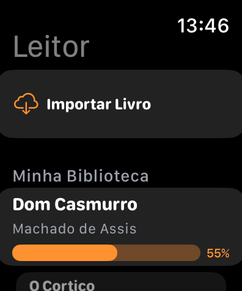
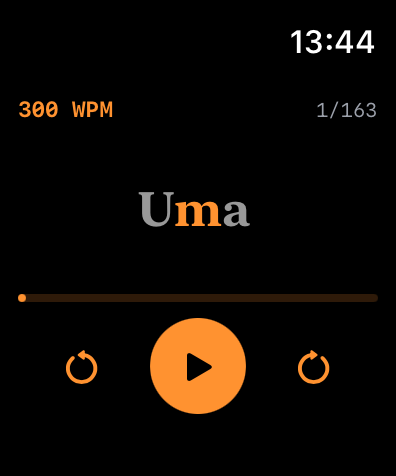
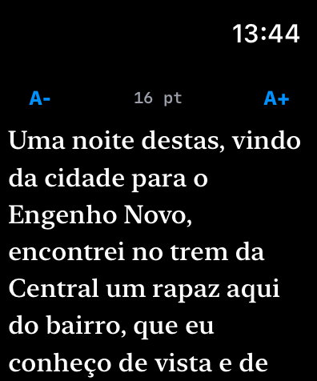
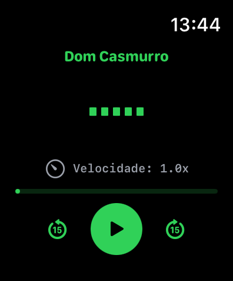
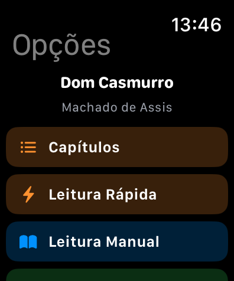
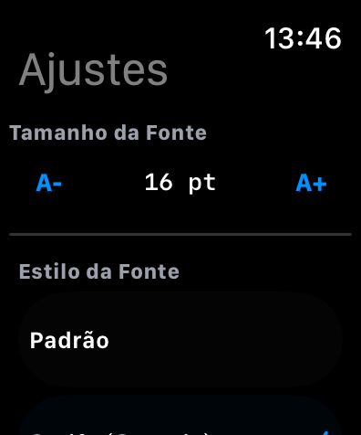

# LeitorWatch — leitura rápida no pulso

Um leitor de livros para o Apple Watch: importa o arquivo do iCloud Drive e oferece dois modos de leitura — **RSVP** (uma palavra por vez, no centro da tela, no ritmo que você escolher) e **TTS** (leitura em voz alta pelo relógio). O objetivo é ler em fila de banco, no ônibus, na esteira — sem tirar o celular do bolso.

## O que tem de real aqui

- **Dois motores de leitura** no mesmo aparelho: RSVP com velocidade ajustável e TTS via `AVSpeechSynthesizer`.
- **Importação do iCloud Drive** (`CloudDocuments`): os livros vivem na pasta do app no iCloud e aparecem no relógio — entitlements declarados em `Sources/LeitorWatch.entitlements`.
- **Navegação por capítulos** com progresso de leitura salvo.
- **Projeto declarativo**: `project.yml` (xcodegen) é a fonte da verdade do `.xcodeproj`.
- ~1.800 linhas de Swift/SwiftUI em 10 arquivos.

## Telas

Executado no simulador de watchOS 26.5 (build com as correções descritas no commit de fix):

| Tela | Leitura RSVP | Leitura manual |
|---|---|---|
|  |  |  |

| Leitura por voz | Opções do livro | Ajustes |
|---|---|---|
|  |  |  |

## Como rodar

```bash
xcodegen generate
open LeitorWatch.xcodeproj
# rode no simulador de watchOS (10.0+)
# para iCloud de verdade, use uma conta com o container configurado
```

## Status
Projeto pessoal de estudo (watchOS only, SwiftUI). Roda no simulador; a importação do iCloud requer provisionamento com a sua conta de desenvolvedor. **Não publicado na App Store.**

Stack: Swift, SwiftUI, AVFoundation (TTS), iCloud Documents, xcodegen.
